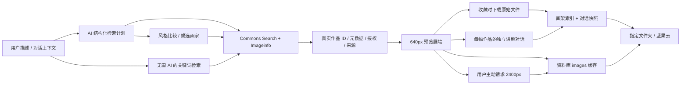

# 架构与交互设计记录

调研日期：2026-10-24。以下为阅读公开项目说明后得到的设计参考；本项目没有复制这些仓库的实现代码。

## GitHub 上有哪些相近项目

**[mdruuu/art-tauri](https://github.com/mdruuu/art-tauri)** 是贴近技术栈的参考：Tauri 桌面艺术展示，强调全屏、多显示器和快捷键。适合借鉴沉浸欣赏和馆藏源的组织方式；当前项目以“对话寻画 → 收藏 → 重访”为主流程，后续可以添加全屏展览和播放队列。

**[cfpramod/open-museum-mcp](https://github.com/cfpramod/open-museum-mcp)** 提供多开放馆藏检索及一致数据结构，强调逐馆藏的权利验证与引用。这里吸收的是数据边界：作品 ID、来源页、作者、授权、预览和原图分别建模；模型只生成检索计划，真实结果由数据源确定。不要把“网站开放访问”直接当成“每件作品无条件可再使用”。当前仅呈现 Commons 返回的授权标记，不实现这个项目的严格权利过滤器。

**[mattvr/vr-art-gallery](https://github.com/mattvr/vr-art-gallery)** 提供 WebXR 高分辨率作品展示，并有素材预处理流程。它适合参考空间化欣赏，而桌面对话搜索需要优先解决动态检索、渐进加载、失败恢复和收藏持久化，因此第一版采用二维展墙。

这些参考没有在此次调研中呈现完全相同的“中文自然语言对话 + Tauri + Google Art Project + 可同步本地画架”完整流程，所以使用独立实现。此结论仅限本次检索到的项目，并非整个 GitHub 的穷尽调查。

## 数据流

模型不接收系统文件访问权、不执行任意工具调用、不下载任意 URL。寻画 AI 输出 `query` 与 `explanation`；风格比较还输出其他画家的候选与理由，候选先通过 Commons 检索验证。这个验证只证明馆藏中有相关文件，不证明 AI 的艺术史判断正确。作品讲解接收该画的缩略图 URL 与馆藏资料。所有下载限定 Wikimedia 官方图像域名，限 JPEG/PNG/WebP；预览上限 32 MB，收藏原图上限 512 MB，不自动跟随重定向。网络请求带超时；缓存并发为 3；相同版本图片下载在前端合并。

## 数据源上的容易遗漏之处

默认来源是 [Google Art Project 分类](https://commons.wikimedia.org/wiki/Category:Google_Art_Project)，修正了用户链接末尾的中文逗号。其作品分散在子分类里，仅查询顶层 categorymembers 会漏掉大量作品。本版使用全文检索短语 `"Google Art Project"` 加用户关键词和文件类型，覆盖相关作品文件；这是基于元数据匹配的范围，不是严格递归分类成员证明。将来若要求严格成员资格，需要构建分类遍历索引或基于 Wikidata 的确定性集合。

[Imageinfo](https://www.mediawiki.org/wiki/API:Imageinfo) 可一次返回缩略图地址、原图尺寸和扩展元数据。返回的元数据含 HTML、隐藏翻译标签和编辑按钮，必须转换为纯文本；不能直接 `innerHTML` 插入页面。2026-10 实际请求已返回 `thumb.wikimedia.org` 缩略图域名，下载白名单同时支持它与 `upload.wikimedia.org`。

使用 [CirrusSearch](https://www.mediawiki.org/wiki/Help:CirrusSearch) 的文件命名空间检索，并保留 offset 继续加载。作品按 page ID 去重，但同一画作的不同扫描文件会有不同 ID，本版不会误把它们合并为同一文件。后续可以引入 Wikidata 作品 ID 做“同一作品 / 多个数字版本”的二级归并。

## 功能交互补齐

- **直搜与 AI 清楚区分**：没有密钥时仍能试用，不把关键词映射伪装成 AI。相似风格提问先由 AI 结合前文作品资料形成比较和其他画家候选，再检索真实作品；直搜模式明确提示需要 AI，不机械重搜原作者。请求失败明确显示错误，用户主动重试，避免隐藏额外计费调用。
- **缩略图与原图分层**：列表默认小图，右键可按需加载 2400px；点击画作直接全屏并加载 Commons 原图。全屏里滚轮缩放、左键拖动，不要求 Ctrl。收入画架时也下载原图，缩略图仍用于卡片浏览。
- **两类对话**：灵感寻画可跨作品继续检索；作品讲解绑定 Commons 作品 ID，再次打开接续此前的解释与追问。历史分栏避免把一个画家的搜索和一幅画的讲解混在一起。
- **收藏先落盘再显示成功**：网络失败不会生成看似可离线、实际上没有图片的收藏。
- **缓存与收藏分离**：浏览图片可缓存；收藏索引控制“我的画架”。移除收藏不立即破坏对话中仍引用的图像。
- **状态与异常可见**：加载占位、搜集进度、停止、空结果、来源错误、保存错误、重试、缺图占位、删除确认。
- **同步目录可迁移**：空目录复制、已有目录打开、相对路径、旧目录保留、保存冲突阻断。
- **键盘操作**：输入框 Enter 发送、Shift+Enter 换行、中文输入法组合输入保护、Escape 关闭弹窗、弹窗焦点循环和操作焦点样式。
- **密钥与可同步偏好分离**：Base URL / 模型可同步，密钥留在系统凭据库。

## 演进顺序

1. 先补真实供应商 API 联调、桌面打包和更多平台测试。
2. 追加资料库版本迁移、导入导出、备份恢复 UI、缓存配额与孤立缓存清理；数据量增大后拆为每会话文件，减少坚果云快照冲突。
3. 多数据源适配器：统一 `search / details / preview / license` 接口；接入 Met、AIC 等时逐源核验授权与速率限制。
4. 推荐增强：以用户主动选择的收藏标签驱动推荐；可选上传收藏摘要，需要清楚告知哪些信息会发给 AI。当前的推荐只依据对话上下文。
5. 欣赏模式后续增加键盘左右切换、画架分组和策展排序。

本版不自动进行跨设备冲突合并。共享单个 JSON 文件比同步运行中的 SQLite/WAL 更容易备份和理解，但不适合多人同时编辑或极大资料库。这是为个人、单机轮流使用所做的明确取舍。
