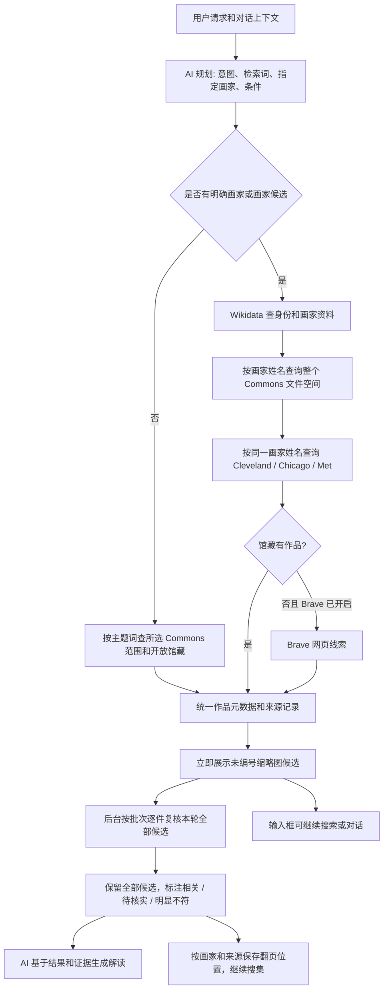
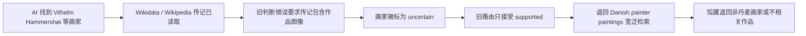

# 艺术搜索链路核查（2026-10-28）

这里的“艺术搜索 skill”是应用内部的检索流程，不是独立的 `SKILL.md`。实现分布在 `src/services/ai.ts`、`entityResolver.ts`、`retrieval/`、`artSearch.ts`、`commons.ts`、`review.ts` 和 `src/App.tsx`；桌面网络请求由 `src-tauri/src/main.rs` 执行。

## 当前流程

按画家搜索绕过默认 Google Art Project 范围，因为该范围不包含 Commons 上该画家的全部作品。首次从 Commons 每位画家最多取 24 条 API 文件结果，之后可“继续搜集”，各画家的 Commons 和其他馆藏分页位置分别保存。馆藏顺序是 Commons 先行，其他馆藏补查；Brave 网页只在没有馆藏作品时补充线索。

作品是否符合要求，由馆藏作者字段、作品元数据、已读取的来源页与实际提供给模型的缩略图共同判断。未证实的项目标为“待核实”；明显不符也显示并说明原因，方便用户发现来源或判断错误。复核与结果解读在后台按每批六项进行，覆盖本轮全部候选；用户可以继续发起下一轮搜索，或停止这一轮复核。来源页读取数量仍有限制，未取得来源页的作品会根据现有元数据和缩略图判断，证据不足时保持待核实。

## 这次故障的根因和修正

现在画家身份和作品图像分阶段判断：传记阶段只核对身份、国别、时代与创作类型；画家资料为 `uncertain` 时仍按姓名检索，后续逐件核对作者。即使身份服务暂不可用，只要用户明确写了画家姓名，也直接按该姓名搜索整个 Commons。搜索结果保留来源查询、候选和复核依据，不以模型的判断隐藏候选。

## 对 Commons 示例的核查

用户给出的 [Vilhelm Hammershøi 媒体搜索](https://commons.wikimedia.org/w/index.php?search=Vilhelm+Hammersh%C3%B8i+&title=Special%3AMediaSearch&type=image) 与应用的 API 查询并非同一个界面。Commons 另有 [Paintings by Vilhelm Hammershøi 分类](https://commons.wikimedia.org/wiki/Category:Paintings_by_Vilhelm_Hammersh%C3%B8i)及子分类。之前只返回少数作品，主要是路由退回宽泛词、默认来源范围以及单页上限共同造成；不能把网页上的所有搜索结果当作已经通过作者、图像格式和授权核对的作品。

当前 Commons 使用文件命名空间全文搜索、`filetype:bitmap`、`imageinfo` 和缩略图地址，再按作者字段检查。JPEG、PNG、WebP 文件可进入展墙；TIFF、缺缩略图或无法识别的作者标记可能遗漏。Commons 搜索的排序和分词与网页 MediaSearch 也可能不同，因此“网页上能看到”不保证第一页 API 结果完全相同。

## 仍需改进的部分

- 推荐画家目前最多取两个进入首轮实名搜索，第三位可能只留在规划资料中。
- 首轮最多展示 48 件馆藏候选；来源返回更多结果时需要继续搜集。
- 一轮候选会全部进入后台复核；用户可控的费用/调用上限还未实现，作品多时可能产生多次模型调用。
- 画家姓名匹配依赖馆藏作者元数据，旧名、别名和未标注作者可能漏掉；同名画家需要更严格的 Wikidata QID 对齐。
- Commons 的分类成员关系尚未建立独立索引；当前使用文件全文搜索，不能宣称穷尽该画家的全部 Commons 文件。
