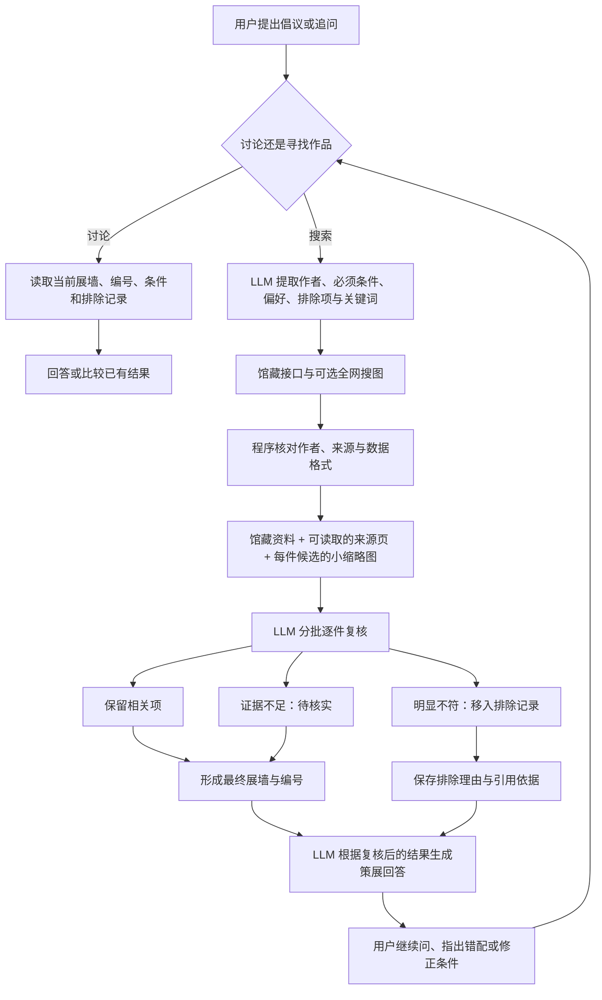

# AI 策展人：检索、逐件复核与持续对话方案

更新日期：2026-10-25（Asia/Shanghai）。

## 当前交付与暂停状态

用户要求暂停功能开发，先记录方案并上传最新代码。因此本次保存当前代码状态，不继续完成复核功能或生成新安装包。

此前已完成并打包的增强：

- AI 区分讨论已有结果和发起新搜索，规划检索关键词与作者约束。
- 来源覆盖 Commons、Cleveland、Chicago、Met；可选 Brave 全网图片搜索，并提供 Google 图片跳转。
- 指定作者时按作者字段核对，过滤不匹配作品。
- 搜索结果交给 AI 生成回答，后续对话携带真实作品资料、编号和最近一组结果。
- 每幅画显示简短选择原因，并保留实际检索依据；原因随作品和对话保存。
- 对话和结果解读可附最多三张相关缩略图；图片输入失败时改用文字并提示。

暂停时，代码中已经加入以下**尚未完成验收的草稿**：

- 检索计划新增必须条件、偏好、排除项，以及备用关键词。
- `src/services/pageEvidence.ts`：提取来源页文字与有上限的来源补充。
- `src/services/review.ts`：分批逐件复核与保留／排除／待核实判定。
- Rust `read_source_page`：受限的公开 HTTPS 网页读取。
- 对话主搜索与分页的复核接线、排除记录和待核实状态展示。

以上草稿不代表已完成真实模型联调，也不代表已逐件确认图片或网页可读。最后一个已校验安装包是增加“选择原因”的版本；它不包含本次未完成的逐件复核草稿。

## 要解决的问题

原来的“结果解读”和“选择原因”主要解释已有候选，并不等于 AI 已逐件筛选。只给少量结果附图，也无法声称其余作品已通过视觉检查。

目标是让策展人先理解需求，再发现候选，最后依据实际证据剔除明显不符项。让用户能追溯：这件作品为什么出现、AI 得到了什么证据、为什么保留或排除、哪些条件还无法确认。

## 建议的完整互动流程



### 1. 先把倡议转成可检查的条件

例如：“想看 Artem Rohovyi 本人的风景画，偏冷色，不要人物肖像。”

| 字段 | 示例 | 作用 |
| --- | --- | --- |
| 作者 | Artem Rohovyi，附已知姓名转写 | 作者身份是硬约束，不得偷偷换作者 |
| 必须条件 | 风景画 | 不符合时才有剔除依据 |
| 软性偏好 | 偏冷色 | 用于推荐和排序，不能擅自升级为硬排除条件 |
| 排除项 | 人物肖像 | 复核时检查明确矛盾 |
| 需要图片 | 是 | 颜色、画面主体等不能只靠作者名字判断 |
| 主关键词 | 标准姓名或姓名加主题 | 用于来源适配器检索 |
| 备用关键词 | 同义词、姓名转写 | 仅在没有候选时有限尝试，不能改变原意 |

计划应在界面中可查看。用户说“冷色不是必须”时，下一轮应该修改偏好，而不是重新猜测整项需求。确有关键歧义时再简短追问，不要求每次都确认。

### 2. 搜索候选，先执行确定性核对

- 关键词由 LLM 规划，查询由应用执行，不能把模型编造的 URL 当作品。
- 优先使用各馆藏的结构化字段，避免统一用一串泛关键词匹配所有来源。
- 指定作者时先检查作者字段，不能因描述或标题提到此人就算命中。
- 全网图片结果作为来源线索，保留图片与原页面的关联，不直接升级为已核实馆藏。
- “没有结果”和“来源失败”分别记录，不能用无关名画填空。
- 备用关键词最多两项，加主查询共三次；只有没有候选时才尝试，来源失败时不连续重试。

### 3. 收集证据：链接不是已读网页

每件候选应携带：作品 ID、标题、作者、年代、描述、来源页、缩略图、实际检索依据。

证据补充顺序：

1. **馆藏 API 的对象资料**：作者、题名等身份信息优先采用馆方字段；并非必须重复抓取所有馆藏 HTML 页面。
2. **来源网页正文**：对资料稀少的馆藏记录，以及全网搜到的官网或画廊线索，读取公开页面文字。剔除导航、脚本等噪声，保留实际引用片段。
3. **小缩略图**：逐批为每件候选附图，核对画面主体、色调和明显类型；缩略图不能支持精细技法或原作真伪判断。

必须区分：页面未请求、页面不可读、页面已读；缩略图未提供、已提供给模型、模型表示无法判断。不能仅因请求成功就承诺模型确实理解了图片。

当前草稿的预算：先读取前六条网页线索，以及最多六件文字资料稀少的馆藏来源页，总计最多十二个去重页面；读取并发三路。其他候选依赖馆藏资料／搜索摘要和缩略图，不能标记为已读来源页。

来源页读取应限制为公开 HTTPS 地址，校验 DNS 地址并固定解析结果，阻止访问本地／私网地址；重定向逐跳校验，不携带模型密钥、浏览器 Cookie 或登录态。草稿采用直连读取任意来源页，固定馆藏与模型 API 仍使用原代理配置。页面需要登录、反爬或依赖脚本时，应明确记为不可读。

### 4. 把复核变成真正的筛选步骤

每批最多六项，最多两批并发，确保候选能逐件提供缩略图。复核输出绑定应用提供的候选 key：

```json
{
  "decisions": [
    {
      "key": "art:123",
      "verdict": "reject",
      "reason": "标题为自画像，与排除人物肖像矛盾",
      "confidence": 0.95,
      "basis": "metadata",
      "quote": "Self-Portrait"
    }
  ]
}
```

| 判断 | 应用行为 |
| --- | --- |
| keep | 保留，解释匹配依据 |
| reject | 从主展墙移走，但保留作品和排除依据供检查 |
| uncertain | 保留为待核实，不能声称已确认匹配 |

程序需要校验：

- key 必须属于当前批次，不能接受新增、重复或缺失的判断。
- 文字依据必须能在本项实际资料或已读取的页面中找到原文。
- 视觉判断只能用于确实附过缩略图的项；没有图片时不能据画面排除。
- 有硬性画面条件却没有有效视觉判断时，保留待核实。
- 只排除把握较高且有证据的明显不符项；当前草稿以模型自评 0.85 作为排除门槛、0.65 作为保留门槛。

上述分数只是模型自评和工程门槛，不是经过校准的真实概率，也不能代替证据。模型的判断仍可能错误，因此需要可查看的排除记录和用户纠正入口。

### 5. 基于复核后的结果再回答

- 最终展墙与编号在复核后确定，避免用户看到“第三张”后它又被悄悄移走。
- 给最后的策展回答传入保留项、待核实项、排除摘要和来源失败信息。
- 每幅画的短理由与实际检索依据分别保留，不能用事后生成的解释冒充程序筛选依据。
- 后续追问使用最近展墙的编号；排除项不混入当前编号。
- 若全部被排除，直接报告结果，不以历史作品或虚构作品补齐。

### 6. 持续对话、分页和异常恢复

- “这张为什么选中”应读取该作品保存的判断和证据，而不是重新编一个理由。
- “第二张不对”先核对这张及原始条件，修正后继续；不应每次都重新搜图。
- “继续找”新增的分页候选同样经过复核，不能绕过筛选。
- 模型不支持图片时可改用文字，但画面条件保留待核实。
- 单批失败、JSON 错误、遗漏判断均不能静默删除作品，应保留待核实并显示失败信息。
- 停止后不接收迟到的判断，保留候选但标为未完成复核。
- 不自动无限搜索或重试。后续可评估“全部剔除后，用同一意图的备用词再搜一次”，在明确次数与费用预算后再实现。

## 暂停时的验证记录

- 当前前端生产构建通过。
- 当前已有的 31 项前端单元测试通过；这些测试主要覆盖此前已完成的功能，**不足以证明新增复核草稿正确**。
- 新的来源页读取、逐批复核和分页筛选，尚未补全专门的单元测试与端到端验收。
- 新增 Rust 网页读取尚未在这次暂停前完成编译／测试验证。
- 真实模型、Brave 密钥、公开网页可读性与真实图像识别效果尚未完成供应商联调。
- 本次不生成包含草稿的新安装包，不把草稿描述为已验收功能。

## 恢复开发时的顺序

1. 检查当前草稿的前端接线、来源页读取、取消恢复和复核记录样式，先完成 Rust 编译。
2. 增加来源页读取的地址／DNS／重定向边界测试，以及 HTML 文字抽取测试。
3. 测试逐件复核：错误作者、明显非作品、画面不符、引用不存在、未附图、低把握、缺失／重复／伪造 key、部分批次失败。
4. 补端到端测试：真的剔除、待核实展示、排除记录保存、复核后编号、连续追问、分页同样复核、停止不留下永久加载状态。
5. 使用固定艺术家和主题做小型真实评测，分别统计作者错配率、明显无关率、错误剔除率、待核实比例、延迟与调用次数。对比启用前后的结果，而不是只看模型回答是否流畅。
6. 完成真实供应商和桌面运行验证后，再生成安装包。

## 相关实现位置

- [检索规划与结果对话](../src/services/ai.ts)
- [多源检索与作者检查](../src/services/artSearch.ts)
- [来源页补充草稿](../src/services/pageEvidence.ts)
- [逐件复核草稿](../src/services/review.ts)
- [对话、分页、展墙与复核记录](../src/App.tsx)
- [Rust 网络读取与安全边界](../src-tauri/src/main.rs)
