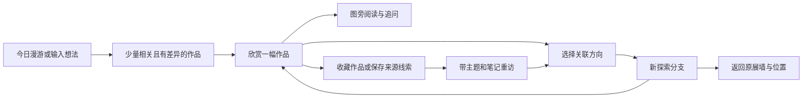
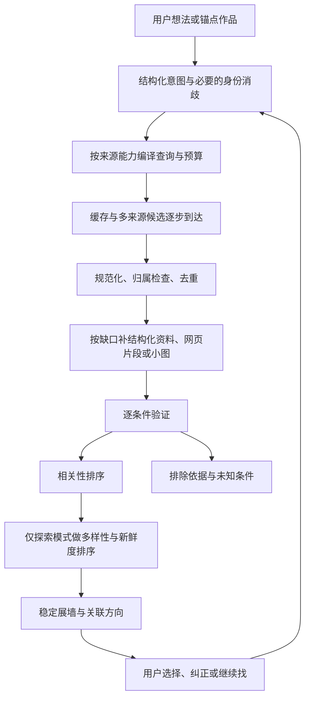

# 拾色 Atelier：产品审视与下一阶段执行方案

日期：2026-10-26。审视基线：`ae445cf`（本地 `main`）。

本文是方案交付，不代表已经实施。面向下一位执行开发者，包括 GPT-6-sol 级别的编码代理。所有后续工单初始状态均为 `TODO`；当前应用代码未因本次审视而修改。

## 1. 核心判断与产品方向

拾色已经是一个具备实际使用价值的个人看画工具：真实馆藏检索、沉浸浏览、作品讲解、收藏、历史、图片容错和本地资料库已经组成基本闭环。但它还不是一个经过验证的“个人艺术发现系统”。当前最薄弱的环节是候选覆盖、作品理解和探索的连续性；继续单独加强最后一层 AI 筛选，收益会受到上游限制。

建议下一阶段的定位是：**帮助用户从一幅喜欢的作品出发，逐渐发现自己的审美，也遇到此前不知道该如何搜索的艺术。**

这意味着同时做好两种不同任务：

| 用户任务 | 成功标准 | 产品应优先保证什么 |
| --- | --- | --- |
| “帮我找到它／找到符合条件的作品” | 作者正确、条件符合、来源可核对 | 精确性、身份消歧、证据、结果稳定 |
| “带我发现一些我没见过但可能喜欢的作品” | 相关又有新意，能理解关联，愿意继续探索 | 覆盖、多样性、用户控制、连续的探索路径 |

不能用同一个“相关度”分数混合解决这两类任务。严格找某位作者时不应为了多样性换作者；自由探索时也不应永远被已喜欢的画家和同一种配色包围。

下一版应让用户感受到四个变化：

1. 首页可以接触到预设名家以外的作品，并记得哪些已经展示过。
2. 输入小众作者或复杂描述时，系统会选择合适的来源与语言，不会被少量无关结果提前终止。
3. “相似”可以明确选择色调、构图、题材、媒材或时代关联，并在分支探索后回到原处。
4. 检索、核实和图片下载的等待不会打断正在进行的看画、收藏和阅读。

## 2. 审视范围与当前完成状态

### 2.1 证据范围

本次阅读了前端主流程、数据模型、所有检索源适配器、AI 规划／回答／复核、来源页读取、本地存储、图片浏览组件、Rust 网络与文件边界、现有设计文档及测试。核对了艺术机构和协议的官方文档。

本次重新运行 `npm test`：42 项通过。上一轮记录的构建、17 项端到端测试、17 项 Rust 测试通过，本次没有重复执行这些检查，也没有完成真实模型／Brave 联调、原生桌面可用性测试或用户访谈。因此下文区分三类判断：代码事实、由代码推导的风险、需要评测的产品假设。测试通过不等于选图质量已被证明。

### 2.2 能力盘点

| 能力 | 当前完成状态 | 下一阶段缺口 |
| --- | --- | --- |
| 看画与基本收藏 | 已实现全屏、同组切换、画质选择、失败后保留收藏、最近浏览 | 真机跨平台验收；收藏组织和重访价值 |
| 作品讲解 | 已实现主动导览、追问、应用内可拖动图片浮层、字号设置 | 图文并排的主流程、解释的来源关联、关键画面位置指认 |
| 多馆藏检索 | Commons、Cleveland、Chicago、Met 已接入 | 来源能力没有充分利用；统一关键词限制召回 |
| 全网补充 | Brave 图片线索和有限来源页正文读取已实现 | 艺术家官网／画廊的主动发现、作品级图文绑定、线索收藏 |
| AI 质量控制 | 规划、作者文本核对、逐件复核、引用检查、排除记录已实现 | 逐条件判断、归属语义、真实质量基准、成本与时延测量 |
| 首页发现 | 可轮换、翻页、本次运行去重 | 作者池仅 15 人；跨启动曝光记录、主题采样和多样性控制缺失 |
| 用户理解 | 当前会话上下文和最近结果可继续讨论 | 稳定的探索意图、用户显式偏好、分支与回退缺失 |
| 资料库 | JSON 快照、备份、冲突检测、目录迁移、密钥隔离已实现 | 版本迁移、查询索引、数据增长性能、恢复 UI |
| 工程可维护性 | 已有服务层与回归测试 | 主应用约 2,582 行、Rust 入口约 535 行且职责集中；协议和运行状态仍耦合 |
| 发布成熟度 | 可构建的个人工具／验证中的 Alpha | 真实供应商与平台验证、质量报告、版本化发布流程 |

应用内拖动浮层不等于可拖到其他显示器的独立系统窗口；若后者仍是需求，应单列产品任务并在原生桌面验收。此项不阻塞本轮艺术发现升级。

### 2.3 应保留的基础

- 收藏资料与下载成功分离；网络异常不会让用户失去收藏意图。
- 模型只处理给定候选，不直接凭空造出可下载作品。
- 来源失败、待核实和排除理由有可见记录。
- 密钥在系统凭据库；任意网页读取有 HTTPS、DNS 和重定向边界。
- 本地优先、可迁移目录、已有文件保护与显式冲突检测。

这些是下一阶段的约束和资产，不能为了重新设计而退化。

## 3. 为什么现在容易反复出现常见画

### 3.1 可以从代码确认的原因

| 发现 | 代码证据 | 产品影响 |
| --- | --- | --- |
| 首页只有五组、每组三位画家 | `src/services/discovery.ts` 的 `periods`、`chooseDiscoveryArtists` | 换页能换作品，却无法跳出这 15 位画家；增加随机数无法解决作者覆盖 |
| 首页已见集合和分页位置在内存 ref 中 | `src/App.tsx` 的 `discoverSeen`、`discoverOffsets` | 重启会丢失曝光记忆；最近打开记录不是所有已展示记录 |
| 首页作者匹配包含标题、文件名 | `discovery.ts` 的 `seed.match` | 题名提到某人、临摹或相关图片也可能进入推荐；需与搜索共用身份判断 |
| 四个馆藏基本共用一个查询字符串 | `artSearch.ts` 的 `searchAcrossProviders` | 各源的作者、材质、主题、年代等能力没有充分使用 |
| 默认 Commons 加入 Google Art Project 文本条件 | `commons.ts` 的 `buildSearch`；`types.ts` 默认设置 | 搜索范围不是全部开放艺术；仅在整体无馆藏结果时扩展会掩盖该源的缺口 |
| Cleveland 固定限制 Painting | `museums.ts` 的 `searchMuseum` | 素描、版画、水彩以外的分类表达可能受限；跨源品类策略不一致 |
| 作品模型只保留少量展示字段 | `types.ts` 的 `Artwork`；三个馆藏 normalizer | 媒材、分类、文化、题材、作者实体与归属限定语未成为可检索维度 |
| 作者核对只是规范化姓名 token 包含 | `artSearch.ts` 的 `matchesArtist` | “after / workshop of / attributed to”与本人作品未被系统区分 |
| 替代检索只在原始结果完全为空时执行 | `App.tsx` 的 `send` 查询循环 | 无关网页线索也能提前结束召回；全被复核排除后没有受预算约束的补查 |
| 相似推荐先让模型列 2–4 位画家，再按姓名搜 | `ai.ts` 的 `planSearch`；`App.tsx` 的 recommendations 分支 | 模型熟悉的画家更容易出现；参照图未作为规划阶段的直接视觉输入 |
| 馆藏 normalizer 要求开放图片及可用图像字段 | `normalizeCleveland`、`normalizeChicago`、`normalizeMet` | 可以研究、可以保存线索，但缺少可下载图像的作品被整个丢弃 |
| 网页证据是截断正文和字符串邻近检查 | `pageEvidence.ts`、`review.ts` 的 `pageSupportsQuote` | 不能充分证明引用属于当前图，也不能证明引用支持某项排除条件 |
| 全部候选补页、复核完成后才出现主展墙 | `App.tsx` 的 `present`；`reviewCandidates` | 慢源和慢模型形成首屏等待链；实际影响尚待测量 |
| 规划、复核和讲解共用同一 AI 请求参数 | Rust `ai_plan` 使用固定 temperature 与 900／4096 输出上限 | 不同任务的结构化长度和兼容性需求未被独立管理 |

### 3.2 结构性偏差

当前链条是“少量熟悉艺术家／英文词 → 开放馆藏中有图片的记录 → 来源排名前几项 → AI 复核”。每一步都可能缩小长尾覆盖，最终形成名家集中。这个问题包含四个不同层面：

1. **知识覆盖**：系统是否知道该作者及其原文姓名、作品所在机构？
2. **检索覆盖**：知道作者后，是否能找到相应对象记录，而不是相关文章？
3. **展示能力**：记录是否有能在应用中显示的预览？
4. **下载权限与可用性**：是否有适合缓存的高清资源？

这四项应分别记录。缺少高清资源不能推导为没有作品；搜索失败也不能推导为艺术家不存在。

“小众”还应有可操作的含义：优先使用“用户未见过的作者”“当前推荐曝光较少的作者”“基准中覆盖不足的作者”，不要让模型凭印象给艺术家贴全球知名度标签。文化、地域和媒材多样性分别衡量，不能用多接几家欧洲馆藏代替文化覆盖。

## 4. 目标用户心流

### 4.1 主路径



主界面以作品和下一步探索为中心。聊天是表达意图和解释选择的入口，不应成为所有操作必须经过的长日志。

### 4.2 三个必须做通的使用场景

**场景 A：从文学感受找画。** 用户说“想看像贡布雷那样安静的乡间，不要旅游照片”。系统把“贡布雷”作为文化／地点线索，保留原文，提炼乡间道路、村落、庭园、柔和光线等可观察方向；“安静”保留为主观偏好。展墙给出不同方向的小组，不把同一个词机械翻译后搜索。出现人物不自动剔除，除非用户明确要求无人。作品旁说明具体联系，不声称作者与普鲁斯特有历史关系。用户选择“更偏村落，少一点花园”，更新意图版本，保留原探索。

**场景 B：找指定小众艺术家。** 先解析姓名与已知别名、原文语言及官网线索；没有实体库记录也可继续以未消歧姓名检索。将“已核实本人作品”“有关来源线索”“暂时没有结果”区分呈现。馆藏查不到时，在预算内找官网、画廊、展览页面；无预览但有可信记录时提供资料卡。绝不改成名字相近的名家，也不把新闻中的配图直接当成该艺术家的作品。

**场景 C：从一幅画发散。** 用户看见作品后选择“相似构图”“同题材不同画法”“同样空间感”“同作者早期／晚期”“给我一个有联系但不同的方向”。每次只改变一个主要维度，并保留面包屑、锚点作品、父展墙、滚动位置和选中项。返回后编号和顺序不变。颜色相近、历史影响、同流派三种关系必须使用不同文案和证据。

### 4.3 页面与交互决策

- **发现页**：默认一组 8–12 件；提供“今日漫游”“沿着我的收藏”“换个方向”。少量主题入口和可解释的新鲜度控制即可，不同时堆满分类树。
- **探索工作区**：作品墙为主，当前意图以可编辑短标签展示；保留聊天输入、关联方向和分支回退。严格条件显式显示，偏好可轻松增删。
- **作品阅读页**：常用宽度默认图文并排；空间不足时可固定图片、展开文字。拖动浮层保留为补充方式，避免用户每次手动排窗。
- **画架**：支持轻量主题分组、笔记、保存来源链接，以及“从这组作品继续找”。原图待下载是资源状态，不是收藏失败。
- **异常**：某个来源失败时仍能看现有内容；缺图卡提供可用的小图或来源入口。不要用一个红色错误占据整轮探索。
- **证据**：默认展示一条有用的选择理由；复核状态、引用与技术错误折叠在详情中。用户不必阅读每张卡的技术诊断才能看画。
- **连续性**：展示后不静默改顺序；补充结果追加。后续证据与初判冲突时保留原卡，标记更新并允许用户选择移除。
- **初次使用**：先允许看画、直接检索和收藏；设置明确区分“AI 导览”和“网页来源发现”两种能力及对应密钥。未配置时说明当前缺少哪种能力，不在每轮探索重复提示整套设置。
- **可达性**：常用入口不只藏在右键菜单；图文并排、条件调整、分支回退和证据展开均可用键盘操作，焦点返回原作品。字号增大后不遮挡收藏和返回按钮。

不建议首版加入地图大屏、三维展厅、复杂知识图谱编辑器或无限自动探索。这些并不直接解决当前的候选质量与心流问题。

## 5. 艺术分类：从单一关键词转向多个独立维度

### 5.1 最小实用分类体系

| 维度 | 示例 | 首选证据与处理方式 |
| --- | --- | --- |
| 对象类型 | 绘画、素描、版画、书法、摄影、雕塑、纺织 | 馆藏分类；“画”默认二维绘画相关对象，可见地调整 |
| 材料与技法 | 油彩、水彩、木刻、蚀刻、墨、纸本、绢本 | 馆藏字段与受控词表；材料与技法分开 |
| 题材／图像内容 | 乡间道路、港口、室内、人物群像、宗教叙事 | 馆藏主题优先；视觉识别补充，注明推断 |
| 形式与构图 | 高视点、水平展开、中央主体、大留白、密集构图 | 视觉描述及用户判断；不冒充馆藏事实 |
| 色彩与光线 | 低饱和、冷暖对照、逆光、暮色 | 图像特征与视觉模型；受扫描和显示影响 |
| 情绪／体验 | 宁静、疏离、热烈、压迫、怀旧 | 用户意图与软性推荐；允许不同理解 |
| 年代与创作阶段 | 年代区间、约年、作者早期／晚期 | 馆藏日期范围；不能把展示字符串直接当准确年份 |
| 创作地域／文化背景 | 创作地点、描绘地点、文化传统 | 分成不同字段；馆藏所在国不是作品文化 |
| 流派／历史关系 | 流派归属、师承、影响、共同展览 | 可靠文字来源；视觉相似不能证明影响关系 |
| 作者及归属 | 本人、归属、工作室、追随者、仿作、佚名 | 作者实体和归属限定语；保留多人创作角色 |
| 观看条件 | 方向、比例、可用画质、局部细节 | 实际图像尺寸和能力；独立于艺术相关性 |

不要一次建立数万个标签。第一版建立约 80–150 个常用概念的可维护集合，覆盖题材、对象、媒材、视觉描述和情绪；每项有稳定 ID、中英文名、已核对的同义词、可选外部概念 URI。优先收纳评测实际使用的词。该数量是实施范围，不是艺术世界的分类边界。

Getty 的 AAT、ULAN、TGN 可分别用于术语、人物和地名对齐，官方提供 Linked Open Data；不是可以直接拿来完成中文情绪检索的现成词库。中文别名与主观描述仍需单独维护并注明出处。[Getty 数据服务](https://www.getty.edu/research-conservation/tools-databases/vocabularies/data-services/)

### 5.2 意图模型

将当前 `required/preferred/excluded` 字符串数组演进为带 ID 的条件，同时保留用户原话：

```ts
type Criterion = {
  id: string;
  dimension: string;
  operator: "include" | "exclude" | "range";
  strength: "hard" | "soft";
  value: string | { from?: number; to?: number };
  originalPhrase: string;
  evidenceNeeded: "metadata" | "visual" | "either";
};
type ExploreIntent = {
  id: string;
  revision: number;
  mode: "exact" | "thematic" | "explore";
  originalRequest: string;
  artistRefs: string[];
  criteria: Criterion[];
  anchorWorkKeys: string[];
  relation?: "composition" | "color" | "subject" | "medium" | "history" | "contrast";
};
```

这是接口草图，执行者需补完整枚举与运行时校验。原文“不是一定要冷色”修改的是该条件强度，不是新增相反条件。“不要人物肖像”不等于“画里不能有人”。每次修改意图生成新 revision；搜索与复核记录引用对应 revision，避免混用前后条件。

### 5.3 元数据原则

每个分类值保留 `rawValue`、规范化值、语言、来源、获取时间和依据类型。缺失就是 unknown，不自动等于不符合。供应商字段与 AI 补充字段分别保存；作者身份和权利信息不能仅靠 AI 标签升级为已核实。

## 6. 艺术源头：先挖深，再有目的地拓宽

### 6.1 来源分层与接入顺序

| 层次 | 来源与优先级 | 要解决的问题 | 限制与验收重点 |
| --- | --- | --- | --- |
| 现有馆藏深挖 | P0：Chicago、Cleveland、Met、Commons | 使用作者、分类、媒材、主题、日期等字段，而不只取标题和图 | 逐源保存真实字段；保留未知；同一意图编译不同查询 |
| 身份与术语补充 | P0：Wikidata；P1：小范围 Getty 对齐 | 多语言姓名、同名消歧、术语映射 | 实体库无记录不是否决；不依赖全站 SPARQL 扫描 |
| 官网／画廊／展览 | P0：已有 Brave 配置增加网页检索通道 | 找开放馆藏以外、特别是在世或小众艺术家的来源 | 先发现可信站点，再限域找作品；网页不是自动获得图片下载权限 |
| 新馆藏试点 | P1：SMK 优先，Rijksmuseum 次选 | 扩大区域作者和对象类型，验证通用适配器 | 每次只上线一个；比较新增作者和有效结果，不以接入数量验收 |
| 聚合／跨文化补充 | P1：Europeana 或 Smithsonian 二选一做试点 | 减少仅靠欧美名家与少数机构的覆盖 | 要密钥或更复杂对象过滤；聚合记录需跨源归并，按实际覆盖报告 |
| 专门资料入口 | P2：经验证的地区馆藏、艺术家作品目录、用户提供来源 | 覆盖特定文化、作者和媒材缺口 | 用缺口清单决定，逐站检查能力；不承诺任意网页都能自动导入 |

官方能力依据：Chicago 文档列有 `style_titles`、`classification_titles`、`subject_titles` 等字段；Cleveland 提供作者、文化、技法等查询过滤；Met 提供媒材、地域、年代等过滤，当前代码使用的 `/v1.1/search` 符合其现行分页文档，不应“修回”旧接口。[Chicago](https://api.artic.edu/docs/) · [Cleveland](https://openaccess-api.clevelandart.org/) · [Met](https://metmuseum.github.io/)

SMK 提供可检索馆藏数据和独立公开领域标记；Rijksmuseum 现行 Search API 无需 API key，返回可解析的 Linked Data 标识及分页链接。后者不能套用旧教程中的 API key／旧返回结构。[SMK](https://www.smk.dk/en/article/smk-api/) · [Rijksmuseum Search](https://data.rijksmuseum.nl/docs/search/)

Europeana 的搜索提供多种 metadata/media facets，使用需要申请 API key；Smithsonian 提供 API 和数据集，部分记录只有元数据而无开放媒体。这正是将“发现记录”和“下载图片”分开建模的理由。[Europeana Search](https://europeana.atlassian.net/wiki/spaces/EF/pages/2385739812/Search) · [API key](https://www.europeana.eu/en/how-to-register-for-and-manage-an-api-key) · [Smithsonian](https://www.si.edu/openaccess/faq)

增加 SMK／Rijksmuseum 主要改善特定欧洲艺术覆盖，不能宣称已经解决亚洲、非洲、拉美或当代艺术覆盖。每个来源试点必须给出增量覆盖表；下一来源由缺口和用户任务决定。

### 6.2 小众艺术家检索流程

1. 保留用户姓名，识别语言；查询缓存中的实体和别名，再做一次受限实体搜索。
2. 存在同名候选时，结合年代、地区、作品或官网线索消歧；仍有歧义才让用户选择。
3. 检索相应馆藏及作者原文姓名。作者官网、代理画廊、展览机构是“候选来源”，核对页面作者信息和作品标识后再建立关联。
4. 用网页搜索发现站点，再做最多一层的站内作品页扩展；优先作品目录、作品详情、展览列表。
5. 分别输出作品对象、作品线索、作者／展览资料。照片、商品、海报不是仅因包含姓名就被视为原作。
6. 无法找到时说明本次搜索过哪些来源类别、还有哪种能力未开启。允许“保存这条研究线索”，不替换用户的作者。

Wikibase 的实体搜索支持 labels/aliases，适合做姓名候选与实体 ID 获取；检索返回并不等于作者身份已确认。[Wikibase API](https://www.mediawiki.org/wiki/Wikibase/API)

Brave 图片搜索和网页搜索是不同通道；图片搜索文档明确没有 offset 分页，不能把现有“继续找”直接映射为虚构的图片分页参数。网页路径应独立处理结果、来源和预算。[图片搜索](https://api-dashboard.search.brave.com/api-reference/images/image_search) · [网页搜索](https://api-dashboard.search.brave.com/api-reference/web/search/get)

### 6.3 来源评估契约

每个 provider 登记：支持的查询维度、语言、分页方式、可获取字段、图片能力、元数据／图片权利字段、缓存策略、速率策略、失败类型和最近契约检查日期。接口不支持某字段时，在本地后过滤或标为未核实，不能伪装成已在源头执行。

优先利用现有 API 的结构化资料。来源页补充用于明确缺口，不能每个结果都抓全文；新增一个来源前先抽样 20–30 个对象，检查长尾作者、无图记录、归属限定语和失败行为。

## 7. 作品、数字图像和来源证据分开建模

### 7.1 建议的领域对象

| 对象 | 作用 | 最小必要字段 |
| --- | --- | --- |
| WorkRecord | 某个来源描述的艺术对象 | `recordKey=provider:sourceId`、题名、作者关联、原始字段、规范化分类、来源 URL |
| WorkGroup | 经证据确认的同一作品集合 | 应用内稳定 ID、成员 recordKey、合并依据、版本 |
| ArtistRef | 作者候选或实体 | 稳定本地 ID、来源实体 ID、原文名、别名、消歧状态 |
| Attribution | 作者与作品的归属关系 | `by/attributed_to/workshop/follower/after/unknown`、作者 ID、来源依据 |
| ImageAsset | 作品的数字版本 | `assetKey`、来源、尺寸、用途、服务能力、权利声明、缓存状态 |
| EvidenceItem | 支持某个判断的资料 | 来源 URL、对象关联、片段、定位方式、获取时间、内容 hash |
| CriterionAssessment | 某个条件的判断 | criterionId、`supports/contradicts/unknown`、evidenceIds、判断方法、版本 |
| ExploreSession | 用户探索路径 | 当前意图 revision、父分支、锚点、稳定结果集、视图位置 |
| ExposureEvent | 实际曝光与反馈 | work/artist 引用、事件类型、时间、会话；不把请求成功当成已看过 |

不要一开始要求每件作品都有 Wikidata ID。`provider:sourceId` 是可靠身份底座；只有确有共同作品实体或明确机构关联，才建立 WorkGroup。视觉相似哈希只能帮助标记疑似重复，不能把同系列不同作品或临摹合并。

### 7.2 四种互不替代的状态

- 相关性：相关／不符／证据不足。
- 归属：已核实本人／有限定的归属／待核实。
- 可用性：有预览／仅资料／高清失败／本地已缓存。
- 权利：来源给出的 metadata 和 image 声明；unknown 仍为 unknown。

第一版不实现法律判断引擎。按来源声明决定应用支持的展示／下载路径，保留原始声明和出处；无法确认媒体使用条件时仍可保存记录和外部链接。来源正文只保存实现追溯所需的有限片段、hash 与时间；缓存和持久化遵循各服务条款，不能假定任意全文均可永久存储。

### 7.3 兼容迁移

现有数字 ID 和缓存文件路径继续可读。先增加 `recordKey` 与映射，保留旧字段适配；不要为了字符串 ID 批量重命名图片文件。新模型稳定后再升级资料库版本：写前备份、完整校验、失败不覆盖旧文件、可重复迁移。恢复旧版程序必须明确不支持新版本文件，不能悄悄丢字段。

## 8. 检索与 AI：建立有界、可评测的流程

### 8.1 推荐流程



### 8.2 查询规划与扩展

规划器输出“查询计划”，不是一串通用英文。每个子查询带 provider、语言、字段、目的、来源约束、预算和 cursor。严格作者可查询实体／规范名；主题查询应分解对象类型、题材与年代；视觉偏好先用于排序，不强塞进不支持视觉检索的馆藏接口。

每轮最多一次质量驱动的补查：例如经过确定性核对和首批复核后，相关作品少于 4 件，或候选仅来自一位作者且意图是自由探索。补查只能保持硬条件、改变同义词／语言／来源／软性方向；明确的硬条件不能为了凑数被自动放宽。预算耗尽后展示已有结果并给出下一步，不自动递归。

### 8.3 AI 职责与确定性职责

| 环节 | 适合 AI | 应由程序保证 |
| --- | --- | --- |
| 理解 | 从自然语言提炼意图、描述锚点的视觉特点 | schema 校验、保留原文、版本化、权限／预算 |
| 召回 | 建议同义词、原文检索词、可能的探索方向 | 实际 API 查询、来源选择、分页、有效 URL |
| 复核 | 基于限定资料判断逐个条件、表述不确定性 | 候选 ID、引用定位、图片供给事实、归属规则 |
| 排序 | 小候选集的主观相关度比较 | 先遵守硬条件、稳定序号、去重、多样性约束 |
| 讲解 | 组织事实与观察、提供阅读线索 | 每条事实的来源可回溯、用户选择的对象不串线 |

不推荐让多个模型自由讨论后投票作为第一步；同源错误可能被重复强化，成本也更难控制。先用一个清晰、有日志的流程证明每个环节有增益。

### 8.4 逐条件证据，替代单一结论

现有单个 `basis` 无法表达“作者有元数据依据，颜色来自视觉，年代未知”。新复核返回每项 CriterionAssessment，再由程序聚合：有一条硬条件被有效证据明确反驳才可排除；软偏好不符只影响排名；缺资料保留未知。

字符串引用存在、模型自评 0.85，以及“已发送图片”都不是判断正确的充分证明。需要验证引用所指的对象、条件以及否定／归属上下文。模型自评分只可作为诊断或辅助排序，不对用户展示成准确率。以人工标注评测确定排除策略，尤其看错误剔除率。

### 8.5 网页读取的升级方式

当前前 4,000 字和标题附近 800 字策略可以保留为低可信回退，但不能继续充当作品级身份依据。升级顺序：

1. 优先馆藏结构化对象与详情 API；其次作品页中的 JSON-LD、图注、标题与相邻描述。
2. 抽取候选块，保存作品题名、作者、图片 URL／图注关联和段落定位；同页多个作品各自成组。
3. 通用正文抽取只作补充。可评估 Mozilla Readability，但它面向阅读内容，并不提供作品归属校验；不要指望换一个库就解决画廊列表页。[Readability 官方说明](https://github.com/mozilla/readability/blob/main/README.md)
4. 对每个事实保存短引用与定位；不能把整页概括绑定给每张图。只对有相关图文关联的片段做确定性排除。
5. 读取失败、需登录、验证码、脚本页面均可降级为来源线索。保留现有 DNS／重定向检查；解析过程不执行远端脚本，也不自动跟随不限数量链接。

不以模拟人工点击或绕过限流作为核心方案。公开来源无法读取时，用结构化接口、缓存、其他来源或外部页面入口继续用户任务。

### 8.6 多样性与“意外的相关”

第一版可用可解释的规则重排：先按相关性分层，再惩罚同一作者、同一作品重复版本、近期已曝光和单一来源过度集中。自由探索的 10 件首屏，可实验“6 件较贴近、3 件邻近方向、1 件有明确联系的跨方向作品”；这是实验配比，相关候选不足时不硬凑。

严格作者模式关闭跨作者配额；指定地域／文化时不为了表面多样性混入别的地域。任何多样性规则都不得跨过硬条件。

跨方向作品要说明保留了什么、改变了什么，例如“同样的俯视构图，换成木刻”；不能仅写“你可能喜欢”。用反馈区分“作者不对”“题材不对”“这次不想看”“少推荐这个方向”，避免一次跳过永久封锁某位作者。

### 8.7 调用预算与响应体验

以下是第一版可调默认上限与目标，不是当前测量结果，也不是外部服务承诺：

| 项目 | 默认策略 |
| --- | --- |
| 身份补充 | 每轮最多 2 次外部实体查询；优先缓存，不为每个普通候选逐一查询 |
| 来源查询 | 首轮至多 4 个 provider-search 操作；质量补查至多 2 个；单独计数详情请求 |
| 详情读取 | 每轮最多 24 次，优先按缺失字段和候选价值排队；有缓存不重复请求 |
| 原始候选池 | 最多 48 件；先确定性检查与去重 |
| 首轮深入 AI 复核 | 最多 12 件，每批 4–6 件；其余按用户继续浏览逐步处理 |
| 网页补充 | 首屏优先 2 页；整轮最多 6 页、同域并发 1、全局最多 3 |
| 模型调用 | 正常最多 1 次意图规划 + 2–3 次复核 + 1 次汇总；兼容重试计入，整轮硬上限 7 |
| 时间预算 | 正常探索 30 秒软截止；达到后返回已完成部分，后台取消待发请求；用户可主动继续 |
| 首次内容目标 | 本地热缓存 p95 ≤ 1 秒；正常网络首组可欣赏内容 p50 ≤ 5 秒、p95 ≤ 15 秒 |
| 图片预取 | 只预取当前及相邻少量缩略图；高清按需，收藏状态立即落盘 |

严格任务首屏可以先展示已核实身份和题材的结果；需要视觉核实但尚未完成的候选可在明确的“待确认”区查看。已显示卡片使用稳定 `resultSetId + itemId`，不因后续复核重排编号。源、批次、图片各自完成，不必等待所有来源一起结束。

预算由共享计数器管理，主搜索、补查、视觉降级重试共用，不能每进入子函数又获得一份新预算。计数器至少记录搜索、详情、网页、模型、图片数和阶段耗时；服务返回 usage 时记录 tokens，不返回时标为未知，不估造实际费用。针对用户模型配置可选单次成本上限，费用依据该用户填写／确认的价格计算。

这里的四个来源操作包含网页／图片搜索，不是“四馆全搜后再无限附加 Brave”。路由器可以选择三个合适馆藏加一个网页查询；详情、身份查询和页面读取各有独立上限，同时受整轮时间预算控制。未发出的低优先级任务可放弃，已经发出的取消尽力而为；结果隔离必须确定性生效。

### 8.8 AI 使用体验与兼容性

- 将用户的模型配置转成能力记录：文本、图像输入、可用结构化响应方式、最近一次有效测试及失败原因。使用用户主动测试或真实请求中获得的结果，不在每次搜索重复测试全部能力。
- 规划、复核和讲解分别配置输出 schema、输出长度和温度；供应商不支持某参数时使用已知兼容配置。不能把所有 HTTP 400 都解释为“不支持看图”。
- 响应解析失败最多进行一次受预算约束的格式修复；认证、限流、额度、图片获取失败、JSON 截断分别处理。保留候选并允许重试当前阶段，避免重跑整条链。
- 上下文优先级为：当前意图与 revision、锚点及当前结果引用、与本次问题相关的证据、必要的对话摘要。历史长文本和全部作品正文不应在每一批复核中重复发送。
- 讲解把“馆藏记载”“画面观察”“艺术史一般背景”“主观解读”区分表达；涉及具体作品历史的陈述应可定位来源。所谓风格关联可以是审美比较，不能无证据升级为真实师承或影响。
- 外部网页、馆藏描述和用户导入资料以明确的数据段传入，不拼成拥有指令权的 system 内容；当前 `explainArtwork` 的馆藏上下文拼接应在 T05 一并调整。引用再可靠，也不能执行其中的指令。
- 保留结构化诊断而非明文密钥。默认本地保存必要诊断；用户可导出脱敏报告。上传给模型的内容限于本次问题所需资料，新增长期偏好功能时明确是否使用该信息。

模型对缩略图的解读可以为发现提供线索，但细微技法、颜料材质、真伪和艺术家动机都不应从缩略图直接确定。这个能力边界应体现在提示词和结果展示中，而不是堆成每次回答的免责声明。

## 9. 技术架构取舍

### 9.1 保留技术栈，按职责提取

React + TypeScript + Tauri 适合当前本地优先桌面工具，无证据支持重写成服务端应用。建议按具体工单提取边界：

```text
src/domain/                  # 作品、身份、意图、证据、探索会话契约
src/services/providers/      # 逐源查询编译与规范化
src/services/retrieval/      # 路由、预算、去重、补查、排序
src/services/evidence/       # 页面与对象证据抽取
src/services/ai/             # 规划、视觉描述、复核、讲解、兼容配置
src/features/explore/        # 探索工作区与状态控制
src/features/discovery/      # 首页采样和曝光记忆
src/features/library/        # 收藏、线索、分组、迁移
src-tauri/src/network/       # 调度、限流、来源读取、图片能力
src-tauri/src/library/       # 持久化、备份、迁移
```

这是目标职责，不要求第一张工单就移动所有文件。先在现有服务外建立接口和测试，再移动；不以文件变短作为验收指标。

### 9.2 必须先明确的接口

- `Provider.search(ProviderQuery, Cursor?, RequestContext)` 返回记录、下一游标、实际已应用条件和结构化错误。
- `Provider.getDetails(recordKey, fields)` 补充缺失字段；不得把不支持的过滤条件报成已应用。
- `SourceCapabilities` 声明搜索、详情、图片、语言和权利字段能力。
- `RetrievalRun` 保存 intentRevision、预算、源状态、cursor、候选和稳定结果集。
- `ReviewService` 返回逐条件判断与引用，UI 不直接处理模型原始 JSON。
- `ImageResolver` 根据 asset 的实际能力选择预览／高清地址，不用硬编码尺寸标签代表实际分辨率。

### 9.3 请求与任务状态

使用明确的任务状态（planning/retrieving/enriching/reviewing/ready/partial/cancelled/failed）和 runId。并发回调必须验证 runId 与 sessionId；取消后丢弃晚到结果，后端支持取消待发队列与可取消 HTTP 请求。已落盘候选在重启时从“处理中”恢复成 partial，而不是永久等待。

逐 host／服务类别调度，并共享失败缓存、`Retry-After`（秒值和日期值）、退避和熔断。源未配置、无结果、过滤后空、限流、暂时故障分开记录；不把图片 403 一律当成整个馆藏不可用。不能用轮换来源规避同一服务的限额。

### 9.4 资料库与缓存

短期保留便于同步的用户资料快照，增加版本迁移和写入合并；避免每个流式 token 或进度事件写整个资料库。画像／曝光、探索结果引用、证据快照需要有大小与保留策略。

搜索响应、可重建索引和模型复核缓存放在本机缓存层，按规范化查询、来源版本、模型／提示词版本、意图 revision 和证据 hash 区分。用户收藏、笔记和探索分支属于持久资料；不能被“清缓存”删除。

当 1,000 件收藏＋100 个探索会话的本地基准暴露启动／写入问题时，再引入分文件资料或本机数据库索引。不要把运行中的 SQLite/WAL 直接当作云盘同步文件；本机派生索引可以重建，用户数据仍通过明确的导出／同步契约流转。

### 9.5 图片能力与原生体验

通过提供方文档和 `info.json`（可用时）确认允许尺寸与 IIIF 版本，保存实际像素。IIIF 2 与 3 的尺寸语法不同，不能统一拼 `full/full` 或统一替换成 `max`；失败时回退到已经可用的小图，并说明“当前最高可用画质”。[IIIF 2.1](https://iiif.io/api/image/2.1/) · [IIIF 3.0](https://iiif.io/api/image/3.0/)

Windows 和 macOS 分别验证全屏恢复、Esc、焦点、图文并排、字号、下载失败与本地收藏。浏览器 E2E 不能替代这些原生行为检查。

### 9.6 暂缓复杂能力

- 不先引入大型代理框架、微服务、云端统一爬虫或全馆藏预下载。
- 不先建立全世界艺术知识图谱；先做稳定作品身份和有限词表。
- 不因“语义搜索”四个字就立即增加向量数据库。结构化字段、多语言查询、候选排序改善后，若视觉主题任务仍明确失败，再做小型 embedding 对照实验。
- 若实验向量检索：仅索引许可允许的本地样本，比较文本与图像检索；保留实体过滤、来源证据、版本与删除机制。向量相近不能证明作者、年代或历史关系。

## 10. 如何证明改善有效

### 10.1 北极星与保护指标

建议产品目标为“有效探索会话比例”：用户找到至少一件自评相关的新作品，并能理解关联、继续探索或保存。不要单独优化点击量、聊天长度和停留时长；用户也可能因为加载慢而停留很久。

| 指标 | 定义与测量方式 | 初版发布目标 |
| --- | --- | --- |
| 精确作者命中 | 人工核实本人归属的结果／声称为本人作品的结果 | 固定反例集 0 个已知误归属；真实样本报告分母，不承诺总体 100% |
| P@10 | 每个任务前 10 个展示项中人工判为相关的数量／10；不足 10 的位置计未命中 | 按 exact/thematic/explore 分组；较基线改善，不以少给结果“刷高” |
| 有效结果产出 | 每任务实际相关作品数、资料线索数，分开统计 | 不以全部标 unknown 或不展示结果换精度 |
| 错误剔除率 | 人工相关、但系统排除的候选／人工相关候选 | 目标 ≤ 5%，并列出具体错误及样本量 |
| 召回代理指标 | 进入候选池的相关对象／人工汇总的候选并集中相关对象 | 只称 pooled recall；不声称知道全网召回率 |
| 新颖性 | 用户本地未曝光作品比例、首次出现作者数 | 候选充足时，连续 5 次刷新不重复同一作品组 |
| 多样性 | 作者、对象类型、地域／文化、来源的有效覆盖；unknown 单列 | 自由探索时 top 10 单作者一般不超过 2 件；有约束时豁免并记录 |
| 证据正确性 | 引用属于当前作品且支持当前条件的比例 | 固定错绑／否定／临摹反例全部通过；真实抽查单列 |
| 响应与成本 | 首内容时间、完成时间、失败率、调用数、可获取的 tokens | 满足第 8.7 节预算；超时可部分交付 |
| 心流完成 | 用户完成“看画→解释→按一维发散→回到原墙→收藏”的比例 | 5 次引导最少的试用中至少 4 次不需帮助完成；仅作小样本门槛 |

T00 冻结具体门槛，默认改善目标为：长尾／多维任务平均 P@10 比基线增加至少 0.10，同时精确身份任务不退化；若相应基线已高于 0.90，则以保持质量并增加有效覆盖为目标。已核对相关对象不足 10 件的稀有作者任务，提前登记为 coverage 任务，单独比较找到的对象和身份正确性，不能事后改变分母。小样本目标用于决定是否继续投入，不能外推为所有用户的质量承诺。

### 10.2 基准集

先建 24 个任务做基线，再扩至 48 个，四类各 12 个：

1. **精确身份**：常见作者、非默认种子作者、中文译名／原文名、同姓作者、after／workshop／attributed to。
2. **多维主题**：媒材＋题材、年代＋地域、否定条件、文学／情绪描述、主观词与硬条件冲突。
3. **探索与长尾**：参照图的构图相似、同题材异媒材、未知作者、非欧洲艺术、在世艺术家来源线索。
4. **连续性与失败**：多轮修改、超过最近八条后的意图保留、分页、晚到结果、无密钥、429／403、网页混图、重启与恢复。

任务必须有用户原话、意图、允许与不允许的变换、核对依据、评判方法。艺术家和实例由真实公开资料确认，不能让模型编一批“正确答案”。先覆盖现有用户提过的贡布雷乡间、相似风格、小众作者、暂不可下载原图等任务。

正确性标注至少采用人工抽查；同一个模型不能既生成结果又独自判定自己通过。歧义样本保留 unknown，由用户／第二位审阅者复核；不强行得到一个漂亮分数。

### 10.3 评测方法

- 基线固定 commit、模型标识、设置、提示词版本、查询、日期、网络环境；模型别名无法固定时注明。
- 离线回放使用允许保留的 API fixture、少量页面证据和图像测试资产；不能用伪造响应证明真实召回。
- 线上测试使用相同任务、相近时间窗，分开记录服务不可达与检索策略失败；失败样本不得无声删除。
- 做四组消融：原流程；新增结构化字段；加来源路由／补查；再加复核和多样性。证明哪一层带来收益。
- 从 48 个任务中留出 12 个，不用于调提示词；发布前一次性检查，避免对任务集过拟合。
- 真实质量、时延和费用达标后再扩来源或增加模型调用。没有实际密钥时可以完成回放框架和大部分实现，但真实验收必须标为阻塞，不能写“已完成”。

## 11. 可执行工单与交付顺序

所有路径中尚不存在的模块均为拟新增。每张工单只实现规定范围，避免把方案中的所有愿景一次装入主应用。工单完成必须附修改摘要、验证证据、剩余限制和实际 commit；代码不通过的工单不得靠文档改成完成。

### T00 — 建立基线与问题账本（P0）

- 依赖：无。
- 输入：本文、当前 `ae445cf`、`tests/`、`src/services/*.test.ts`、已有文档。
- 输出：`docs/evaluation/baseline.md`、24 个起步任务、最小回放格式、已知错误清单；后续扩至 48。
- 范围：记录当前行为与每个阶段输入输出；先使用现有测试与独立评测脚本，不改检索策略。
- 验收：同一 fixture 可重复回放；分别统计召回前、筛选后和展示结果；没有真实密钥的项明确标未运行。列出至少三个最影响使用的实际失败实例，不要求为了数量编造失败。
- 回退：评测是独立目录，不改变产品运行。

### T01 — 引入兼容的领域契约（P0）

- 依赖：T00 的任务格式可用，不必等待所有外部服务恢复。
- 位置：`src/types.ts`、新 `src/domain/`、`storage.ts` 的兼容读取。
- 输出：recordKey、作者归属、分类字段、ImageAsset、意图 revision、逐条件证据的完整 schema；旧 Artwork 适配器。
- 范围：添加新字段并保证旧数据可读；暂不重命名缓存文件、不全面更换 UI。
- 验收：现有收藏、会话、浏览记录和图片路径可无损读入；多源同 ID 不冲突；unknown 不被转成否；临摹和本人具有不同归属状态。
- 回退：先保存新旧兼容字段，关闭新功能仍能使用旧流程；破坏性版本迁移留到 T09。

### T02 — 挖深现有四源的元数据与查询（P0）

- 依赖：T01。
- 位置：`commons.ts`、`museums.ts`、`met.ts`、新 provider 能力登记与查询编译器。
- 输出：每源字段映射表、能力声明、带应用过滤条件的搜索返回；检索记录和媒体可用性分离。
- 范围：优先 Chicago/Cleveland/Met 的作者、类型、媒材、主题、日期等真实字段；Commons 保留原始资料和可得标识。新增字段以官方响应和 fixture 为准，不假设每条都有值。
- 验收：用户找版画时不会被固定 Painting 策略吞掉；无开放原图的允许公开记录能作为资料卡存在；本人／after／workshop 反例不混淆；同意图能编译出不同源查询；Met 保持现行分页契约。
- 回退：逐源功能开关，保留原搜索适配器直至契约测试通过。

### T03 — 多维意图与作者身份解析（P0）

- 依赖：T01、T02。
- 位置：`ai.ts` 的计划逻辑、新 `domain/intent`、`retrieval/entityResolver`、最小意图标签组件。
- 输出：第 5 节的受控词表初稿、姓名候选解析、schema 校验、意图 diff 和版本记录。
- 范围：用户中文原文、英文／作者原文检索词分开；严格条件不被软偏好覆盖。先用可缓存的 Wikidata 有界查找与本地别名；Getty 接口不是该工单硬依赖。
- 验收：“不要肖像”不会错误变成“禁止一切人物”；“更安静一点”不删除作者条件；“不是一定要冷色”能调整强度；未知姓名继续搜索，同名关键歧义出现可选身份；近期八条之外的重要条件仍在 intent 中。
- 回退：保留 localPlan 直搜；实体服务失败用未消歧身份，而不是中断全部搜索。

### T04 — 来源网页与作品级证据（P0）

- 依赖：T01、T03。
- 位置：`webSearch.ts`、`pageEvidence.ts`、Rust `read_source_page` 与新增网页搜索命令。
- 输出：网页搜索与图片搜索分开；作品候选块、有限片段与图文绑定；小众艺术家来源发现。
- 范围：最多一层来源扩展；优先 JSON-LD／图注；通用正文作为回退；先完成少量可信页面类型，不做任意网站通用爬虫。
- 验收：一页多作品不串作者；页面标题重复、否定句、临摹说明、缺图、非 UTF-8 或声明不支持的编码、反爬页、重定向均有合理结果；引用能定位原片段；不可读仍可保存来源线索；没有新开任意下载域名。
- 回退：证据不足保持未知；旧页面文本不能自动升级为作品级确认。

### T05 — 有预算的检索运行器与逐条件复核（P0）

- 依赖：T02、T03、T04。
- 位置：从 `App.tsx` 的 `send/more/present` 提取 `retrieval`；拆分 `review.ts` 与 AI 请求适配；Rust 请求调度。
- 输出：runId/sessionId、共享预算、来源独立状态、一次质量补查、分批结果、稳定 resultSet、逐条件判断和诊断日志。
- 范围：先接当前 UI；UI 只消费领域事件。对实际模型能力建立配置／测试结果缓存，文本降级不反复探测每一批；所有重试计入预算。
- 验收：一条无关网页不能阻止合理补查；全部排除后只允许预算内一次补查；软偏好不会硬排除；已显示编号不漂移；停止与切会话后无迟到污染；恢复后无永久 loading；源 429 不阻塞收藏与已缓存浏览。
- 验收补充：标准首轮模型调用和来源调用不超第 8.7 节默认上限；结构化错误与用户文案分离；图片读取失败不能被报告为已经看懂画面。
- 回退：在 feature flag 下保留旧运行器；新运行记录失败可以部分交付，不能丢掉已落盘候选。

### T06 — 首页发现与连续探索工作区（P0，首个用户价值里程碑）

- 依赖：T03、T05。
- 位置：`discovery.ts`、`features/discovery`、`features/explore`、相关 App 组件。
- 输出：按艺术维度采样的发现池、持久曝光记忆、相关性之后的多样性排序、分支／回退、可选关联方向。
- 范围：首页不再以 15 人白名单作为唯一入口。先用来源分类／主题采样；无法无条件浏览的来源使用可维护的主题种子，不由模型每次生成一批名人。保留旧种子作为故障时显式回退。
- 验收：在候选充足的固定样本中连续 5 次刷新不重复作品组；重启后曝光仍生效；精确作者不触发跨作者配额；从一幅画按两种不同维度能得到不同查询计划；返回父分支恢复原位置与编号。
- 验收补充：首屏能够记录“首次出现作者／文化／对象类型”的真实增量；数据不足要显示局限，不编标签填配额。首屏和原生图文并排做一次人工体验检查。
- 回退：用户可关闭探索排序；清除曝光记录不删除收藏或浏览历史。

### T07 — 用一个新来源验证覆盖增量（P1）

- 依赖：T02、T05、T06；T00 基线可比较。
- 默认选择：先 SMK。若抽样显示对目标任务贡献低，再依据缺口选择其他源，并记录依据。
- 输出：新 provider、字段／图片契约测试、20–30 条抽样审计、上线前后增量报告。
- 验收：新增源带来经核实的新作者或新的有效任务覆盖；身份、图像和权利状态无退化；没有复制一套 App 分支；无图对象仍保留为记录。
- 下一试点：仅在数据证明必要时选择 Europeana／Smithsonian，补文化和媒材缺口；用户未配置其密钥时其余能力正常。
- 回退：单独禁用 provider；已有收藏继续展示来源与本地资源。

### T08 — 画架与用户可控的审美反馈（P1）

- 依赖：T01、T06。
- 输出：主题分组、简短笔记、网页／无图线索收藏、从一组收藏继续探索、显式反馈及可清除偏好。
- 范围：收藏后可选“喜欢色彩／构图／题材／作者”，不强迫填表。会话偏好和长期偏好分别保存；一次浏览不永久改变画像。
- 验收：原图下载失败仍能保存作品／线索；删除某个主题不删除原收藏；“这次不想看”只影响该会话；用户能查看并重置长期偏好；仅发送当前任务需要且用户开启的偏好摘要给模型。
- 回退：分组／偏好为附加信息，旧收藏完整保留。

### T09 — 持久化、缓存和图片能力收口（P1，发布前必要）

- 依赖：T01、T05；如包含 T08 数据则同时依赖 T08。
- 位置：`storage.ts`、Rust library/network 模块、图片解析器、`FullscreenViewer`／`FloatingArtwork`。
- 输出：版本迁移、旧缓存映射、写入合并、崩溃恢复、统一图片能力与来源限流状态。
- 验收：迁移失败不覆盖旧文件；重试迁移无重复收藏；清缓存保留收藏、笔记、主题和分支；1,000 收藏＋100 会话基准有结果；原图不可用回退已有小图；读取 IIIF 版本／尺寸正确；Windows/macOS 的 Esc 和窗口全屏状态恢复通过。
- 回退：迁移前备份和明确的恢复方式；不要求跨设备并发编辑支持。

### T10 — 真实评测、文档统一与发布决策（P0 发布门槛）

- 依赖：最小候选版本 T00–T06；完整候选版本再包含已启用的 T07–T09。即使未做 T08，T09 中迁移／恢复／媒体兼容的必要部分也必须完成。
- 输出：48 任务报告、消融结果、5 次心流试用记录、供应商／网络限制、平台验收记录、更新的架构文档与版本说明。
- 验收：第 10 节指标有分母和实际结果；关键错归属反例无已知回归；至少完成一种真实视觉服务及文本降级；原生平台不在场的验证列为未完成；用户数据无损；只有通过的功能进入默认开启名单。
- 文档要求：纠正 `docs/architecture.md` 中与当前实现冲突的“点击自动下载原图”“收藏需下载成功”等旧描述；文档统一描述最终行为。
- 发布：只有用户要求发布／打包时生成对应产物；不能用测试环境截图或浏览器测试代替桌面验收。

### T11 — 有条件的语义／图像检索实验（P2）

- 启动条件：T10 证明元数据召回已改善，但构图／情绪／视觉主题任务仍有明确缺口。
- 输出：小规模、可删除的派生索引和对照报告；第一步不改变默认体验。
- 验收：在留出任务上相对于 T06/T07 的非向量基线有稳定增益，且错误归属不增加、成本／存储可接受。无明显增益则停止该方向，不继续建设数据库基础设施。
- 回退：清除派生索引即可恢复；用户作品、收藏、证据不依赖索引存在。

### 11.1 里程碑与范围控制

| 里程碑 | 工单 | 用户能得到的可见价值 |
| --- | --- | --- |
| M0：知道问题在哪 | T00 | 能区分缺覆盖、检索错、筛选错和网络失败 |
| M1：候选与判断更可靠 | T01–T05 | 多维条件与作者归属更准确，小众来源可发现，有限补查，渐进展示 |
| M2：探索确实有新意 | T06＋必要的 T09＋T10 | 不限 15 位画家，维度发散与回退，跨启动减少重复；可作为第一版交付范围 |
| M3：长期使用价值 | T07、T08、剩余 T09，再次 T10 | 有证据的来源扩展，收藏组织与可控偏好 |
| M4：证明后再加复杂度 | T11 | 仅在有效时采用语义／视觉索引 |

不要把 T07 新来源数量或 T11 向量数据库作为 M2 的完成条件。已有来源深挖和新的探索流程可以先产生完整的用户价值；也不能只完成内部重构便宣布产品升级完成。

### 11.2 大工单的建议提交切片

为避免编码代理在一个长回合同时修改网络、存储、模型提示词和界面，采用以下顺序；每个切片保持构建可通过，并有独立回退点：

| 工单 | 切片顺序 | 每个切片必须能检查的行为 |
| --- | --- | --- |
| T01 | 契约＋旧格式适配 → 身份／证据字段接通 | 旧样本逐项往返，原路径不变 |
| T02 | 一次一个源 → 统一能力表 | 查询参数、原始字段、规范化结果三者可对照 |
| T04 | 网页搜索通道 → 作品块抽取 → 来源扩展 | 只有第一步时也可返回可用线索；每一步不暗示尚未完成的归属确认 |
| T05 | runId／预算与事件 → 逐条件复核 → 渐进展示 → 一次补查 | 取消隔离、判断聚合、编号稳定、预算共用分别有回归样本 |
| T06 | 曝光持久化与采样 → 规则重排 → 维度探索／回退 → 图文阅读布局 | 先证明候选改变，再证明探索可回到原处，不把全部工作压在最终 UI 联调 |
| T09 | 迁移／恢复 → 缓存写入 → 图片能力 → 原生验收 | 每步都可用旧资料库与已有缓存验证，不要与所有新 provider 同时迁移 |

上线功能开关只用于短期切换新旧实现，不能长期保留两套各自演进的业务逻辑。完成一个里程碑后清理已无回退价值的分叉，保留数据兼容入口。

### 11.3 优先自动回归的行为样本

| 输入或故障 | 必须满足的结果 |
| --- | --- |
| “只看 X 本人”＋`after X` 的记录 | 不进入已核实本人组；归属限定语和来源保留 |
| “不要肖像”＋远景中有小人物的乡间画 | 不因出现人物就确定性排除 |
| “有点忧郁，冷色更好”＋暖色作品 | 偏好不满足只影响排序，不自动排除 |
| 一页有 A、B 两幅画，引用属于 B | A 的条件不能由该引用获得 supports/contradicts |
| 找 X 的原文名，实体 API 无记录 | 保留未消歧身份，按原文继续；不改名为知名作者 |
| 首轮只有无关网页、复核后无相关作品 | 在同一预算内允许一次补查，并记录改变了哪个查询维度 |
| 来源 A 很慢，来源 B 已有可信作品 | B 可先显示；后来 A 的结果不改变已显示作品编号 |
| 用户在复核时换到其他探索分支 | 晚到结果只属于原 run；不能改变当前分支与滚动位置 |
| 收藏过程中原图 403／429 | 收藏资料保留，可用缩略图仍能看，下载状态可重试 |
| 关闭后重启、再次刷新首页 | 曝光仍参与去重，处理中任务恢复为 partial |
| 清理缓存 | 收藏、来源线索、笔记和探索分支都仍在 |

这些样本应落实为少量集成／端到端测试，避免每条规则只测试一个返回布尔值的内部函数。

## 12. 交给 GPT-6-sol 的执行协议

### 12.1 每张工单的共同完成定义

1. 读本文相关节、实际代码和仓库指令；记录当前 commit 与未提交改动，不覆盖已有工作。
2. 把当前工单的输入、输出、数据迁移和失败路径写成简短实现清单。
3. 尽量完成一条端到端的用户路径；内部重构不与多个新产品方向混在同一提交。
4. 对协议边界、身份归属、状态恢复和用户数据写有意义的测试；纯样式变化以人工检查为主。
5. 运行该改动需要的测试；改动共享领域和存储时跑完整回归，不能因局部测试通过跳过迁移验证。
6. 更新工单记录：实际完成内容、验证命令与结果、没有运行的检查、待处理问题。真实服务不可达和无密钥必须明确。
7. 质量未达门槛时分析哪一层失败，不能靠放松硬条件、删掉失败样本、减少展示结果或把所有项标为未知来通过。
8. 用户要求执行开发后，按依赖继续可完成的工作；只有缺少实质决定或外部条件时提出具体问题。方案中的 P1/P2 不因方便而提前混入。

### 12.2 可直接复制的启动指令

> 请执行 `docs/product-strategy-execution-plan.md` 中的 T00，随后按依赖推进 M2 所需工单。先核对仓库当前版本与已有改动；这份方案基线为 ae445cf，若代码已演进，先记录差异再实施。保持 React + Tauri、本地收藏与可迁移资料库。目标是提高实际艺术发现质量、长尾覆盖与连续探索体验，不以增加功能数或模型调用数代替结果。
>
> 每次只处理一个工单或一个可验收的纵向切片，按工单记录输入、输出、验收证据和未验证项。不得把模拟响应测试报告成真实选图质量。所有新来源、检索扩展、网页读取和模型重试使用共享预算；硬条件与作者归属不可被自动放宽。保持旧收藏、会话和缓存可读。来源不足时诚实报告，不替换为名家，不伪造艺术史关系。
>
> 首先产出基线任务和失败分类，再完成领域契约、现有来源深挖、多维意图、小众来源发现、逐条件复核与稳定结果流；然后实现非固定名家首页、维度探索与回退。以 M2 为首个产品交付目标；新增来源、长期画像与向量实验按对应门槛后置。当前没有真实密钥时推进独立工作并列出被阻塞的验收，不要求用户提供明文密钥。

### 12.3 工单记录模板

```md
## Txx — 工单名
状态：TODO / IN_PROGRESS / BLOCKED / DONE
基线 commit：
依赖及其证据：
本次范围：
变更文件：
用户可见行为：
失败／取消／恢复行为：
数据兼容与回退：
测试与实际结果：
真实服务与平台验证：
质量指标与分母：
未验证项／阻塞：
完成 commit：
下一工单：
```

## 13. 首轮决策清单

本方案建议直接采用以下默认决策，执行者不必逐项重新询问：

- 首个交付目标 M2：改善找到什么、为什么出现、如何继续探索。
- 先深挖现有四源，保留“纯关键词／无 AI”可用路径。
- “绘画相关二维作品”作为默认浏览范围，可显式扩展至摄影、书法和其他对象；不把油画作为唯一艺术入口。
- 发现、预览、下载、再使用权利分别处理；无高清的可信作品记录仍有价值。
- 先做可解释规则排序、有限分类与身份对齐；向量检索取决于评测。
- 固定预算、稳定结果集、跨启动曝光记忆和分支回退优先于增加模型数量。
- 用户拥有自己的偏好：显式反馈优先，会话意图与长期偏好分开，可清除。
- 本方案只完成规划。后续实施、真实联调、桌面验收和打包仍需实际执行后才能标为完成。
