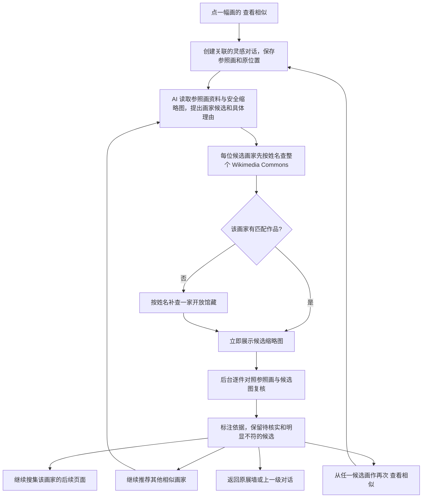

# 相似作品推荐与连续浏览（2026-10-29）

## 当前链路

AI 只提出可能相关的画家和相似理由；作品来自真实馆藏查询。每位画家在 Commons 的第一页限制为 8 条 API 文件结果，减少初次等待和复核成本；后续页面有独立游标。Commons 没有匹配作品时才额外查询一家馆藏，避免每轮固定调用所有馆藏。候选展示不等于已确认视觉相似，后台复核会拿参照画和候选缩略图逐件比较；缺图或模型未读到图片时保留待核实。

继续找分两种：**继续搜集作品**翻现有候选画家的后续页面；**继续找其他相似作品**让 AI 基于同一参照画提出新画家，并告知它避开此前已经展示的名字。每幅结果卡也提供“查看相似”，进入下一层对话；返回按钮回到来源展墙或上一级对话。

## 为什么曾出现“当前模型未读取图片”

当前资料库中《The Martyrdom of Saint Sebastian》有芝加哥艺术博物馆的 600px 缩略图，模型配置为 OpenRouter 的 `deepseek/deepseek-v4.1-flash-1017`。该模型的 OpenRouter 页面标明支持图片输入。旧版 Tauri 在模型返回非成功状态时只显示通用 HTTP 状态，没有保留服务的错误原因，因此旧对话不能反推出精确故障。图片 URL 由模型服务远程抓取，可能在该环节失败；模型或路由明确拒绝图片也是另一种可能。

现在图片请求失败会保留服务返回的简短错误说明。只有明确拒绝图片输入才会对当前模型配置暂时禁用图片；远程缩略图抓取失败不会影响后续作品尝试。作品讲解会分别说明无缩略图、图片输入被明确拒绝，或本次图片请求失败。

## 仍有的边界

- AI 可以提出重复画家；提示中明确包含此前展示的名字，但目前尚无强制排重后的自动补选机制。
- 来源页读取数量和模型看图能力受服务、限流及用户模型配置影响。没有实际送达的图片，复核不会声称看到了笔触或构图。
- 作品与参照画的相似程度目前只有逐件文字标注，没有可比较的数值排序；视觉相似排序需要独立的嵌入模型或更稳定的图像评估流程。
